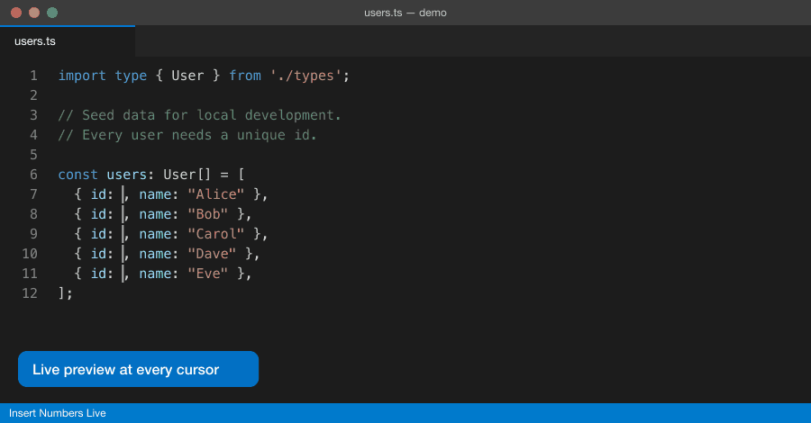

# Insert Numbers Live

Insert numbers, letters, dates, lists, random codes or computed values at multiple cursors, with a **live preview** before anything touches your file.

Pressing the shortcut does not insert right away. Instead, it opens an input box and shows the values faintly at each cursor as you type. Press **Enter** to insert, or **Esc** and nothing changes.

## Usage

1. Place multiple cursors (Alt+Click, `Cmd+Alt+↓` / `Ctrl+Alt+↓`, `Cmd+D` / `Ctrl+D`…).
2. Press `Cmd+Alt+N` (macOS) or `Ctrl+Alt+N` (Windows/Linux), or run **Insert Numbers Live: Insert Sequence at Cursors** from the Command Palette.
3. Type a pattern. The editor previews the result, and the first row of the input box shows the first few values.
4. Press **Enter**. A single **Undo** reverts the whole insertion.

Press Enter on an empty input to insert 1, 2, 3… Your previous inputs are listed below the input box. Use the arrow keys to pick one, and the preview follows.

> **Note:** On Windows/Linux, `Ctrl+Alt+N` is also used by Code Runner. If you have both installed, rebind one of them in **Keyboard Shortcuts**.

## Syntax

### Basic sequences

General form: `start` or `start:step`.

| Input | Result | Notes |
|---|---|---|
| `1` | 1, 2, 3… | |
| `10:5` | 10, 15, 20… | step may be negative: `10:-1` |
| `001` | 001, 002, 003… | leading zeros set the padding width |
| `1.5:0.25` | 1.50, 1.75, 2.00… | decimal places follow start/step; no floating-point noise |
| `0x0a:2` | 0x0a, 0x0c, 0x0e… | width and letter case follow start; step may be hex (`0x10`) |
| `a` / `A:2` | a, b, c… / A, C, E… | after `z` comes `aa`, `ab` (spreadsheet columns) |
| `#I` / `#x:10` | I, II, III… / x, xx, xxx… | Roman numerals, case follows start |
| `2026-01-31:7` | 2026-01-31, 2026-02-07… | step is in days |
| `Mon,Tue,Wed` | Mon, Tue, Wed, Mon… | list, cycles |

Suffixes for basic sequences:

| Input | Result | Meaning |
|---|---|---|
| `1*3` | 1, 1, 1, 2, 2, 2… | repeat each value 3 times |
| `1%3` | 1, 2, 3, 1, 2, 3… | wrap around after 3 values |
| `a*2%2` | a, a, b, b, a, a… | combinable |

### Random codes

| Input | Example | Notes |
|---|---|---|
| `?6` | `K7P2XQ` | 6 characters from A-Z and 0-9 |
| `?8d` | `40912377` | character classes: `d` digits, `a` lowercase, `A` uppercase, `x` lowercase hex, `X` uppercase hex; combine them, e.g. `?10aAd` |
| `?uuid` | `3f2b9c1e-…` | UUID v4 |

- Codes never repeat across cursors in one insertion. If two cursors get the same code, a new one is generated. Repeats are only possible when there are more cursors than possible codes.
- The preview stays stable while you type, and Enter inserts exactly what you see. Click the **↻** button in the input box to generate a new set.
- Random values are not cryptographically secure, so don't use them for passwords or tokens.

### Templates

If the input contains `{` or `}`, it is treated as a template. Text is kept as-is, including spaces, and each `{…}` is a sequence.

| Input | Result |
|---|---|
| `order_{?6}` | order_K7P2XQ, order_9QZ1MB… |
| `item_{001}` | item_001, item_002… |
| `{}. ` | `1. `, `2. `… (`{}` means `{1}`) |
| `{A}{1}` | A1, B2, C3… |
| `{Mon,Tue}-{1*2}` | Mon-1, Tue-1, Mon-2, Tue-2… |
| `row[{=i*2}] = {#I};` | row[0] = I;, row[2] = II;… |
| `{{x}} = {1}` | {x} = 1, {x} = 2… (`{{` and `}}` for literal braces) |

### Expressions

Start with `=`, or use `{=…}` inside a template.

| Variable | Meaning |
|---|---|
| `i` / `n` | index starting at 0 / at 1 |
| `count` | number of cursors |
| `line`, `col` | cursor line and column (1-based) |
| `s` / `x` | selected text at the cursor / that text as a number |

**Operators:**
- Arithmetic: `+ - * / % **`
- Comparison: `== != < <= > >=`
- Logic: `&& || !`
- Conditional: `cond ? a : b`

`+` concatenates when either side is a string (`"..."` or `'...'`), and `%` always returns a non-negative result.

**Functions:**
- Math: `abs`, `floor`, `ceil`, `round(v, digits)`, `sqrt`, `min`, `max`, `pow`
- Formatting: `pad(v, width, char="0")`, `hex(v, width)`, `bin`, `oct`, `roman(v)`, `alpha(v)` (1 → a)
- Text: `upper`, `lower`, `len`, `num`
- Dates: `date("2026-01-01", days)`
- Random: `rand(min, max)`, `randstr(length, "Ad")`, `uuid()`

| Input | Result |
|---|---|
| `=i*i` | 0, 1, 4, 9… |
| `=2**n` | 2, 4, 8, 16… |
| `=pad(n*5, 3)` | 005, 010, 015… |
| `=i%2 ? "odd" : "even"` | even, odd, even… |
| `=x + 1` | select numbers, then increment each one |
| `=x * 1000` | convert selected seconds to milliseconds |
| `="L" + line` | L12, L13… (line numbers) |

### Stop condition

Add `{!condition}` to a template. From the first cursor where the condition is true, nothing more is inserted. Those cursors are left untouched.

| Input | Result with 6 cursors |
|---|---|
| `{1}{!i >= 3}` | 1, 2, 3, (none), (none), (none) |
| `{10:10}{!n*10 > 25}` | 10, 20, (none)… |

If the pattern is invalid, the first row shows an error icon with the reason, and Enter does nothing.

## Settings

| Setting | Default | Description |
|---|---|---|
| `insertNumbersLive.order` | `position` | `position`: number cursors top to bottom. `selection`: in the order the cursors were created. |
| `insertNumbersLive.replaceSelection` | `true` | When text is selected at a cursor, replace it (`false`: insert after it). |
| `insertNumbersLive.historySize` | `20` | How many recent inputs to remember. Clear them with **Insert Numbers Live: Clear History**. |

## License

[MIT](LICENSE)
